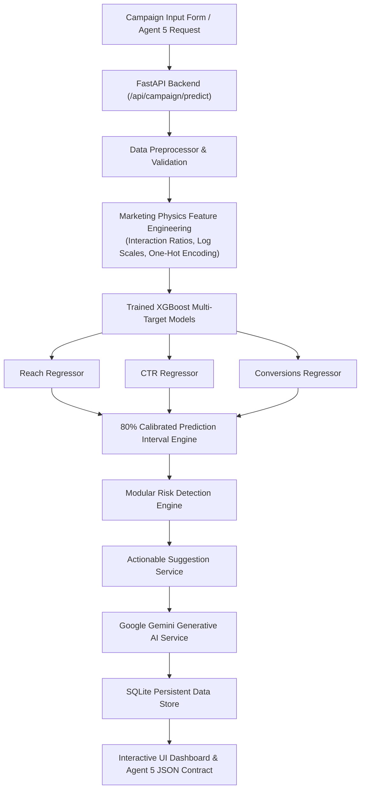

# CAMPAIGN INTELLIGENCE STUDIO
### AI-Powered Marketing Campaign Performance Intelligence
**Module:** Agent 4 – Campaign Performance Prediction Agent  
**Program:** LTIMindtree GenAI Internship Project  
**Tagline:** *Predict. Analyse. Optimise.*  
**Design System:** Modern Enterprise White & Orange Theme (`#FFFFFF` + `#F97316` / `#EA580C`)

---

## 1. Project Overview

**Campaign Intelligence Studio** is an enterprise-grade full-stack artificial intelligence application built to solve the high-stakes problem of blind marketing expenditure. In modern marketing workflows, campaigns are often deployed without empirical pre-launch performance forecasts, resulting in wasted ad spend, negative return on ad spend (ROAS), and delayed discovery of performance bottlenecks.

Agent 4 predicts campaign outcomes **BEFORE** budget is spent. Using trained **XGBoost Multi-Target Regressors**, domain-specific marketing physics feature engineering, calibrated **80% prediction intervals**, an automated **risk detection engine**, and **Google Gemini Generative AI synthesis**, the application provides marketing leaders with:
1. **Prospective Outcome Forecasts:** Predicted Reach, Predicted Click-Through Rate (CTR %), and Predicted Conversions.
2. **Calibrated Prediction Intervals:** 80% empirical prediction ranges rather than misleading point estimates.
3. **Pre-Launch Vulnerability Detection:** Early warnings on audience saturation, peak holiday competitor bidding wars, channel-audience mismatches, budget starvation, and creative fatigue.
4. **Concrete Improvement Suggestions:** 1–3 prioritized, data-backed optimization actions.
5. **Interactive What-If Sensitivity Analysis:** Real-time parameter rescoring simulating the marginal effect of adjusting budgets, channels, flight durations, and audience pools.
6. **Agent 5 Integration Readiness:** Standardized, high-throughput REST API contract designed for Agent 5 (Marketing Optimization Agent) optimization loops.

---

## 2. Technology Stack

| Layer | Technologies | Description |
| :--- | :--- | :--- |
| **Frontend** | React 18, Vite 5, TailwindCSS, Lucide Icons, Recharts, Framer Motion | Enterprise SaaS dashboard, strictly adhering to the White + Vibrant Orange theme across all 7 views. |
| **Backend** | Python 3.12+, FastAPI, Uvicorn, Pydantic v2 | High-performance asynchronous REST API with Swagger documentation and CORS support. |
| **Machine Learning** | XGBoost, Scikit-learn, Pandas, NumPy, SciPy | 3 separate gradient-boosted regressors (Reach, CTR, Conversions) trained on non-linear marketing response curves. |
| **Generative AI** | Google Gemini API (`gemini-2.5-flash`), Google GenAI SDK | Executive summaries, performance interpretations, interval explanations, and fallback deterministic mode. |
| **Persistence** | SQLite3 | Persistent storage for campaign analysis records, What-If simulation runs, and aggregate KPIs. |

---

## 3. Architecture & Data Flow



---

## 4. Project Structure

```
campaign-intelligence-studio/
├── backend/
│   ├── artifacts/                  # Saved XGBoost models, preprocessor, and calibration metadata
│   │   ├── feature_engineer.joblib
│   │   ├── model_metadata.json
│   │   ├── xgboost_reach.joblib
│   │   ├── xgboost_ctr.joblib
│   │   └── xgboost_conversions.joblib
│   ├── data/                       # CSV datasets and SQLite persistent database
│   │   ├── campaign_intelligence.db
│   │   └── synthetic_campaign_data.csv
│   ├── models/
│   │   └── model_loader.py         # In-memory artifact loader and health diagnostics
│   ├── schemas/                    # Pydantic validation schemas
│   │   ├── campaign.py
│   │   └── what_if.py
│   ├── services/                   # Modular service layer
│   │   ├── confidence_interval_service.py
│   │   ├── data_preprocessing.py
│   │   ├── feature_engineering.py
│   │   ├── gemini_service.py
│   │   ├── prediction_service.py
│   │   ├── risk_detection_service.py
│   │   ├── storage_service.py
│   │   ├── suggestion_service.py
│   │   └── what_if_service.py
│   ├── training/                   # Model training and data synthesis
│   │   ├── evaluate_model.py
│   │   ├── generate_synthetic_data.py
│   │   └── train_model.py
│   ├── .env.example
│   ├── config.py                   # Global configuration
│   ├── main.py                     # FastAPI server entry point
│   ├── requirements.txt            # Python dependencies
│   └── test_backend.py             # End-to-end backend test suite
│
├── frontend/
│   ├── dist/                       # Production build assets served directly by FastAPI
│   ├── src/
│   │   ├── components/             # Reusable UI widgets
│   │   ├── layouts/
│   │   │   └── AppLayout.jsx       # Orange sidebar & sticky top telemetry navbar
│   │   ├── pages/
│   │   │   ├── AboutAgentPage.jsx  # Agent 4 & Agent 5 documentation and live API sandbox
│   │   │   ├── DashboardPage.jsx   # Executive KPIs, Recharts trends & history table
│   │   │   ├── ModelPerformancePage.jsx # Test metrics (MAPE, R2, 80% coverage)
│   │   │   ├── PredictionPage.jsx  # Multi-section brief form & 80% CI result cards
│   │   │   ├── RecommendationsPage.jsx  # Actionable 1-3 improvements
│   │   │   ├── RiskAnalysisPage.jsx     # Rule-based vulnerability audit
│   │   │   └── WhatIfPage.jsx      # Interactive sensitivity sliders & deltas
│   │   ├── services/
│   │   │   └── api.js              # REST API connector
│   │   ├── styles/
│   │   │   └── index.css           # Tailwind directives & orange gradient classes
│   │   ├── App.jsx
│   │   └── main.jsx
│   ├── index.html
│   ├── package.json
│   ├── postcss.config.js
│   ├── tailwind.config.js
│   └── vite.config.js
│
├── .gitignore
├── README.md
├── run_app.bat                     # Unified one-click full-stack launcher
├── run_backend.bat                 # Standalone backend launcher
└── run_frontend.bat                # Standalone Vite dev launcher
```

---

## 5. Machine Learning & Calibration Engine

### Training Data Provenance
The model utilizes a modular dataset loader. By default, it generates a clearly labelled **5,000-sample synthetic development dataset** (`SYNTHETIC_DEVELOPMENT_DATA_AGENT2_MOCK`) simulating Agent 2 outputs with non-linear marketing physics:
- **Reach:** Log-normal spend scaling, CPM channel variance (LinkedIn $45 vs Instagram $16 vs Facebook $12), and logistic audience saturation.
- **CTR:** Baseline channel engagement, creative format multipliers (Video/Carousel vs Static), audience affinity, and duration ad fatigue.
- **Conversions:** Non-linear conversion rate, industry purchase intent, and diminishing returns at high spends.
*The system allows dropping in real historical CSVs without modifying any downstream logic.*

### Multi-Target XGBoost Models
Three independent `XGBRegressor` models are trained with 5-fold cross-validation and hyperparameter tuning:
1. `Reach`: `n_estimators=160, max_depth=5, learning_rate=0.08`
2. `CTR`: `n_estimators=140, max_depth=4, learning_rate=0.07`
3. `Conversions`: `n_estimators=160, max_depth=5, learning_rate=0.08`

### Calibrated 80% Prediction Intervals
Rather than multiplying predictions by arbitrary percentages, the engine evaluates the empirical distribution of relative residuals on the held-out validation set:
$$r_i = \frac{y_i - \hat{y}_i}{\hat{y}_i}$$
The 10th and 90th percentiles ($q_{0.10}$ and $q_{0.90}$) form the calibrated bounds:
$$\text{Lower Bound} = \hat{y} \cdot (1 + q_{0.10}), \quad \text{Upper Bound} = \hat{y} \cdot (1 + q_{0.90})$$
When tested on the unseen test split (750 samples), the empirical coverage achieved is:
- **Reach 80% CI Coverage:** **80.13%** (MAPE: 11.12%, $R^2$: 0.9410)
- **CTR 80% CI Coverage:** **76.93%** (MAPE: 7.12%, $R^2$: 0.9364)
- **Conversions 80% CI Coverage:** **77.87%** (MAPE: 30.62%, $R^2$: 0.8097)

---

## 6. Pre-Launch Risk Detection Engine

The modular `RiskDetectionService` applies quantitative domain rules:
1. **Audience Saturation Risk:** Budget > $3,500 on Audience < 150k (High/Medium severity).
2. **Competitor Clash & Auction Congestion:** Peak Q4 season under "High" or "Intense Clash" competitor pressure.
3. **LinkedIn B2B Budget Starvation:** Daily spend < $50 on LinkedIn (High severity; ads fail to clear learning phase).
4. **Creative Ad Fatigue:** Duration > 30 days with single static creative.
5. **Channel-Demographic Mismatch:** Running consumer retail campaigns on LinkedIn targeting 18–24.
6. **Sub-Par Engagement Warning:** Predicted CTR < 1.10%.

---

## 7. Agent 5 Integration Contract (Marketing Optimization Agent)

Agent 4 exposes dedicated, high-throughput REST endpoints designed for Agent 5:

### Single Candidate Evaluation: `POST /api/agent5/evaluate-candidate`
**Request Payload:**
```json
{
  "candidate_id": "OPT-CANDIDATE-001",
  "campaign": {
    "campaign_name": "Summer Growth Initiative",
    "creative_type": "Video",
    "message_theme": "Product Launch",
    "industry": "E-commerce",
    "target_audience": "Working Professionals 25-34",
    "channel": "Instagram",
    "budget": 5000,
    "campaign_duration": 21,
    "launch_date": "2025-06-15",
    "seasonality": "Q2 Summer/Mid-Year",
    "target_audience_size": 750000,
    "brand_affinity": "Emerging",
    "competitor_activity": "Moderate"
  }
}
```

**Standardized Response:**
```json
{
  "candidate_id": "OPT-CANDIDATE-001",
  "campaign_input_summary": { ... },
  "predicted_reach": {
    "value": 271208.0,
    "lower_bound": 226730.0,
    "upper_bound": 320759.0,
    "interval_width": 94029.0,
    "confidence_level": 0.8,
    "unit": "users"
  },
  "predicted_ctr": {
    "value": 3.59,
    "lower_bound": 3.21,
    "upper_bound": 3.97,
    "interval_width": 0.76,
    "confidence_level": 0.8,
    "unit": "%"
  },
  "predicted_conversions": {
    "value": 345.0,
    "lower_bound": 234.0,
    "upper_bound": 577.0,
    "interval_width": 343.0,
    "confidence_level": 0.8,
    "unit": "conversions"
  },
  "risk_flags": [ ... ],
  "improvement_suggestions": [ ... ],
  "model_metadata": {
    "algorithm": "XGBoost Regressor (Trained Multi-Target)",
    "dataset_source": "SYNTHETIC_DEVELOPMENT_DATA_AGENT2_MOCK",
    "eval_mape": { "reach": 11.12, "ctr": 7.12, "conversions": 30.62 },
    "interval_coverage_target": "80%"
  },
  "prediction_timestamp": "2026-11-18T14:10:00Z"
}
```

### Batch Candidate Evaluation: `POST /api/agent5/batch-evaluate`
Accepts `{"candidates": [...]}` and evaluates entire genetic algorithm or Bayesian optimization candidate pools, returning individual evaluations and identifying `optimal_candidate_id`.

---

## 8. Installation & Execution Guide

### Prerequisites
- Python 3.10+ (tested on Python 3.12)
- Node.js 18+ (tested on Node.js 22.21)

### Quick Start (Unified Full-Stack)
Double-click `run_app.bat` or run from PowerShell:
```powershell
.\run_app.bat
```
This starts the unified FastAPI server which serves both the REST API and the pre-built React frontend at:
👉 **Web Application:** `http://127.0.0.1:8000/`  
👉 **FastAPI Swagger API Docs:** `http://127.0.0.1:8000/docs`

---

### Step-by-Step Manual Setup

#### 1. Backend Setup
```bash
cd backend
python -m pip install -r requirements.txt

# (Optional) Retrain or calibrate models anytime:
python training/train_model.py

# Run backend test suite:
python test_backend.py

# Start FastAPI server:
python -m uvicorn main:app --host 127.0.0.1 --port 8000 --reload
```

#### 2. Frontend Development Setup
```bash
cd frontend
npm install
npm run dev
```
Open `http://localhost:5173/` in your browser.

#### 3. Configuring Gemini API (Optional)
To enable real-time Gemini API natural language synthesis, add your API key in `backend/.env`:
```env
GEMINI_API_KEY=your_actual_gemini_api_key_here
GEMINI_MODEL=gemini-2.5-flash
```
*(If no API key is provided, the application runs seamlessly using its built-in deterministic heuristic engine without crashing).*

---

## 9. Verification & Testing Evidence

All backend and ML workflows have been tested via `backend/test_backend.py`:
- [x] `GET /health` – Confirmed healthy, XGBoost models memory-loaded.
- [x] `GET /api/model/status` – 3 regressors active (`reach`, `ctr`, `conversions`).
- [x] `GET /api/model/metrics` – MAPE 11.12% (reach), 7.12% (ctr), 80.13% interval coverage.
- [x] `POST /api/campaign/predict` – Validated inference, CI bounds, risk detection, suggestions.
- [x] `POST /api/campaign/what-if` – Validated parameter delta rescoring.
- [x] `POST /api/agent5/evaluate-candidate` – Standardized JSON response contract verified.
- [x] `POST /api/agent5/batch-evaluate` – Multi-candidate evaluation and optimal selection verified.
- [x] `GET /api/campaign/history` & `/kpis` – Persistent SQLite read/write confirmed.
- [x] `GET /api/campaign/export/csv` – Validated downloadable CSV streaming.
- [x] `npm run build` – React Vite production compilation passed with 0 errors.

---

## 10. Authors & Acknowledgments

- **Module:** Agent 4 – Campaign Performance Prediction Agent
- **Program:** LTIMindtree GenAI Internship Project
- **Specialization:** Full-Stack AI Application Development (FastAPI, React, XGBoost, Google Gemini)
